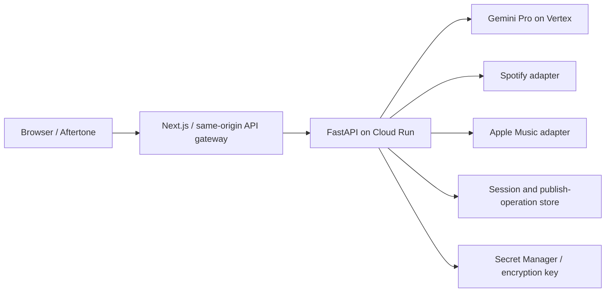

# Aftertone — product and backend plan

Date: September 7, 2026. Status: proposed implementation plan; no backend deployed.

## September 8 implementation scope

The user authorized starting frontend and backend implementation in parallel, **local only, with no deployment**. This overrides hosted setup prerequisites for the first development slice. Use FastAPI on loopback, SQLite for encrypted sessions and publish operations, and the Next.js same-origin gateway. Real provider adapters should report missing configuration honestly; credentials/access are still required before live validation. Cloud Run, Firestore, Cloud Tasks, IAM changes and budgets remain future work. Do not provision resources or treat local implementation as approval for deployment.

## Scope and decisions

The user chose **Aftertone**, requested a retro/fun frontend and logo, Gemini Pro using their existing GCP project, and Spotify and Apple Music login. AI-generated playlists come later. This plan assumes photo-to-playlist remains the v1 entry point. Support individual album-cover photos, including CD/vinyl packaging where recognizable; do not promise shelf segmentation, audio recognition, or arbitrary image-to-mood generation.

The current Next.js app has two mocked seams: recognition in `lib/mock-recognition.ts`, and publish in `hooks/usePlaylist.ts`. Keep the frontend and replace these seams incrementally. Earlier July/August plans remain historical references; this plan supersedes their Flash-Lite default, signed-cookie token storage, hardcoded provider behavior, and disc-only scope.

## Architecture choice

| Approach                                        | Tradeoff                                                                                | Recommendation                            |
| ----------------------------------------------- | --------------------------------------------------------------------------------------- | ----------------------------------------- |
| FastAPI on Cloud Run + current Next.js frontend | Two runtimes, but matches prior design and GCP identity/model access                    | Recommended                               |
| Next.js full-stack on Cloud Run                 | One TypeScript runtime; rewrites the existing Python plan                               | Viable if the team prefers all TypeScript |
| Next.js on Vercel + GCP backend                 | Convenient frontend previews; requires deliberate same-origin proxy and deployment auth | Optional hosting variant                  |

Retain FastAPI, `google-genai`, Pydantic, and an async HTTP client. Add a small server-side session and publish-operation store, proposed Firestore, instead of pretending stateless cookies can safely solve credential storage and retry recovery. No scan history or permanent user account is required in v1. No database or service has been provisioned by this planning work.

Browser API requests stay under the frontend origin. The gateway forwards only allowlisted API routes to a configured backend, preserves required cookies/status codes, and does not cache authenticated responses. When services are separate, authenticate gateway-to-Cloud-Run traffic using platform identity; document the local development exception. This avoids depending on third-party cookies across Vercel and run.app domains. Choose the concrete frontend host before auth implementation.

## GCP setup

Local `gcloud config get-value project` returned `interview-assistant-507123`. This confirms local configuration only, not billing, model permissions, or quota. Use explicit `--project` flags rather than changing the global project.

Update, October 25, 2026: Aftertone now uses the dedicated No Hands Stack project `nhs-aftertone` with `gemini-4-argon`. See `AGENTS.md`.

Before implementation rollout:

- Confirm this project is the intended shared project, its billing, Vertex API access, model/region availability and quotas.
- Use Aftertone-specific service names, service accounts, secrets, labels and store namespaces. Inspect any existing Firestore database and its immutable location before proposing another database or indexes. Leave interview-assistant resources alone.
- Select an available Gemini **Pro** model ID and location through a small image/schema smoke test. Require `GEMINI_MODEL` in configuration rather than guessing a default. A consumer Gemini subscription does not establish this project's API permissions.
- Local identity: ADC. Cloud Run: dedicated attached service account with least-privilege Vertex access and access only to Aftertone secrets/store records. No downloaded service-account keys.
- Configure request deadlines, max instances, per-session recognition limits and a budget alert. Budget alerts are notifications, not hard spending caps. Measure latency and token usage before estimating cost.

Configuration names: `GOOGLE_CLOUD_PROJECT`, `GOOGLE_CLOUD_LOCATION`, `GEMINI_MODEL`, `FRONTEND_ORIGIN`, `SPOTIFY_CLIENT_ID`, `SPOTIFY_CLIENT_SECRET`, `SPOTIFY_REDIRECT_URI`, `APPLE_TEAM_ID`, `APPLE_KEY_ID`, `APPLE_PRIVATE_KEY`, `SESSION_TTL_SECONDS`, `TOKEN_ENCRYPTION_KEY_VERSION`, `STORE_DATABASE_ID`. Exact deployment wiring belongs to the setup milestone. No secret values in planning files.

## Authentication and connections

V1 uses a browser session with one active music service at a time; both services are first-class supported choices. Switching service clears provider-derived selections and re-resolves the original user inputs. Do not infer that Spotify and Apple identities belong to one permanent user. Simultaneous linked accounts and cross-device history are a separate phase.

**Spotify:** Authorization Code + PKCE, cryptographic one-time state bound to the initiating browser, exact redirect validation, short state TTL, backend code exchange, refresh-token rotation and refresh concurrency control. Start with private playlist publishing and minimal required scope; add public publishing only when the user-facing control and scope are implemented. Do not request listening history for photo recognition.

**Apple Music:** Configure MusicKit JS with a server-minted, scoped developer JWT. Request MusicKit authorization from an actual user gesture, then pass the Music User Token to the backend through a CSRF-protected handoff. Validate it with an authenticated Apple API request and resolve the user's storefront. Handle denied consent, missing subscription, expired authorization, and blocked popups. MusicKit authorization connects the music service; it is not Sign in with Apple. A normal Apple Music subscription alone does not provide the developer signing key; verify Apple Developer Program access and the MusicKit identifier/key setup.

**Session:** random opaque cookie, `Secure`, `HttpOnly`, `SameSite=Lax`, short explicit expiry. Store only a hashed session identifier in the server store; envelope-encrypt provider credentials with key versioning. Check expiry in application code because TTL cleanup is asynchronous. Rotate the session after authorization, reject CSRF on mutations, and clear/delete credentials on disconnect. Rate-limit token minting and connection endpoints. Never log tokens, image bytes, or authorization headers.

Proposed retention defaults: session absolute lifetime 24 hours; publish-operation records 24 hours; raw photos processed in memory and not retained. Revisit these defaults during account/history design. Treat all image/model output as untrusted, including instructions embedded in images.

## Provider constraints verified September 7, 2026

- Spotify development mode requires an owner with Premium and ordinarily limits new apps to five authorized test users. Public launch needs a separate access/readiness decision; owning a subscription does not grant unrestricted API access. [Quota modes](https://developer.spotify.com/documentation/web-api/concepts/quota-modes).
- Use the current development-mode routes: create with `POST /me/playlists`, append via `/playlists/{id}/items`; catalog search needs pagination and removed response fields cannot be required. [Migration guide](https://developer.spotify.com/documentation/web-api/tutorials/february-2026-migration-guide).
- July's newer update increased developer Client IDs to 25 and made development quota shared across those apps. Distinguish quota exhaustion from transient rate limits rather than endlessly retrying both. [July update](https://developer.spotify.com/blog/2026-07-23-web-api-quota-updates).
- Apple requires developer authorization plus user authorization for personalized library operations. Validate request limits and actual playlist behavior against the connected account; do not inherit the old speculative 300-track batch size. [MusicKit](https://developer.apple.com/musickit/), [user authentication](https://developer.apple.com/documentation/applemusicapi/user-authentication-for-musickit), [create playlist](https://developer.apple.com/documentation/applemusicapi/create-a-new-library-playlist).
- Spotify policy prohibits ingesting Spotify content into AI models. Keep catalog responses out of Gemini prompts; attribute and link catalog content to Spotify, and provide disconnect/deletion. Provider separation alone is not a policy approval for the overall product; recheck the proposed multi-provider experience before public release. [Developer policy](https://developer.spotify.com/policy).
- Gemini model versions and locations change. The model catalog is a source for selection, not evidence of this project's access. [Google model catalog](https://cloud.google.com/vertex-ai/generative-ai/docs/models).

## Recognition and catalog flow

1. Validate file size, decoded pixel count and actual image type server-side. Proposed v1 bounds: 10 MiB/image, 20 megapixels, 20 images/draft; JPEG, PNG and WebP. Show an actionable HEIC conversion message until conversion is deliberately supported. Normalize orientation and strip metadata; client resize is an optimization, not validation.
2. One image/request; retain the current client queue bound of two. Use cancellation and a draft generation/version to ignore late responses after removal, reset, or service change.
3. Gemini Pro extracts candidate artist/title and an `unrecognized` outcome using structured output. Treat self-reported confidence as uncalibrated. Do not ask for a fabricated tracklist.
4. Query the active provider catalog in the account's market/storefront. Paginate album tracks and validate the edition. Return canonical provider IDs and links, with missing metadata nullable.
5. Return `matched`, `needs_review`, or `unrecognized`, plus candidate evidence and alternatives. Users can correct every match. Mark corrections `user_confirmed`; never present a fake 100% model certainty.
6. Keep user photos and extracted input separate from provider metadata. Repeated photos may legitimately identify the same album; replace mock-only uniqueness enforcement with a visible duplicate-selection rule.

## Domain and API contracts

Names below are proposed contracts, not implemented endpoints.

| Type                          | Required meaning                                                                                                |
| ----------------------------- | --------------------------------------------------------------------------------------------------------------- |
| Session                       | Expiry, connection state, active service, market/storefront; never returns tokens                               |
| ScanItem                      | ID, client preview, status, generation/version, recognition result                                              |
| ProviderAlbum / ProviderTrack | Service, catalog ID, market/storefront, source URL, canonical metadata; optional fields stay optional           |
| RecognitionResult             | Outcome, candidates, selected match, evidence and source (`model_match` or `user_confirmed`)                    |
| PlaylistDraft                 | Ordered selected tracks/albums, name, active service, revision, input source (`photo` now; `prompt` later)      |
| PublishOperation              | Session owner, request hash, idempotency key, status, playlist ID/URL if known, completed batches, missed items |

| Method / route                        | Contract                                                           |
| ------------------------------------- | ------------------------------------------------------------------ |
| GET `/api/session`                    | Connection state and capabilities                                  |
| GET `/api/auth/spotify/login`         | Start redirect with state and PKCE                                 |
| GET `/api/auth/spotify/callback`      | Validate state, exchange, establish session                        |
| GET `/api/auth/apple/developer-token` | Short-lived MusicKit configuration; no private key                 |
| POST `/api/auth/apple/session`        | Validate user grant and establish session                          |
| DELETE `/api/session`                 | Disconnect and delete stored credentials                           |
| POST `/api/recognize`                 | One multipart image plus draft generation; structured outcome      |
| GET `/api/albums/search?q=...`        | Debounced correction search with pagination                        |
| GET `/api/albums/{providerId}`        | Canonical album and complete paginated tracklist                   |
| POST `/api/playlists`                 | Validated draft + idempotency key; operation ID, 202 while working |
| GET `/api/playlist-operations/{id}`   | Owner-only progress, terminal result or uncertainty                |

Errors use `{code, message, retryable, retryAfterSeconds?, requestId}`. Cover unauthenticated/expired sessions, invalid uploads, unrecognized images, catalog miss, rate limit, quota exhausted, upstream unavailable and ambiguous publish. Publishing revalidates IDs and capabilities server-side instead of trusting client track metadata.

## Reliable publishing

Use ordered selection with first-occurrence track deduplication; disclose this rule and any unavailable tracks before publishing. Freeze a draft revision on publish. Scope idempotency to the session and normalized request hash: same key/same payload returns the same operation; same key/different payload returns conflict.

Create the operation transactionally before provider writes. A durable dispatch mechanism (proposed Cloud Tasks) invokes a private worker route, with a scheduled recovery check for pending records whose enqueue failed. Task delivery is at least once: use leases and compare-and-set updates. Persist the provider playlist ID immediately when known and checkpoint completed batches. Never launch untracked background work after returning a Cloud Run response.

Provider writes are not globally transactional. A timeout can mean the playlist or append succeeded. Reconcile against the user's playlist when possible; otherwise return `needs_attention` with the known playlist link and do not automatically replay the uncertain write. Do not claim exactly-once external side effects. Partial completion reports accurate added/skipped/unknown counts and offers an explicit recovery action. A client double-click must not create another operation.

## Implementation milestones

Each milestone is independently reviewable. Establish real credentials in secure local configuration before integration work; fakes belong only in tests.

| Step                   | Work / likely files                                                                                      | Completion evidence                                                                                                           |
| ---------------------- | -------------------------------------------------------------------------------------------------------- | ----------------------------------------------------------------------------------------------------------------------------- |
| B0 Access and hosting  | `docs/setup/`, account setup, explicit project, model smoke test, origin strategy, provider capabilities | Both accounts can authorize, model responds to an image; record exact scopes/model/location without secrets                   |
| B1 Service foundation  | `backend/pyproject.toml`, `app/config.py`, `main.py`, DTOs, health, CI                                   | Config fails safely, structured errors, health test, pinned dependency workflow                                               |
| B2 Session persistence | `auth/`, store repository, encryption and CSRF helpers                                                   | Tampering/expiry/ownership, rotation, disconnect, concurrent refresh tests                                                    |
| B3 Spotify             | `providers/spotify.py`, OAuth routes                                                                     | Real private playlist with a few explicitly chosen test tracks; refresh, pagination, 429/403 contract tests                   |
| B4 Apple Music         | `providers/apple.py`, developer token and MusicKit handoff                                               | Real authorization, storefront resolution and small playlist; denied/expired/subscription cases                               |
| B5 Recognition         | `recognition/vision.py`, `service.py`, image validation, correction API                                  | Curated user-owned photo set: correct, ambiguous, wrong edition, non-cover, rotated and oversized cases; measure latency/cost |
| B6 Publishing          | Operation repository, task worker, reconciliation and status API                                         | Duplicate click, duplicate delivery, timeout after create/append, partial batch and permission loss tests                     |
| B7 End-to-end release  | FE integration, deployment config, logging and budgets                                                   | Browser flow passes for both user accounts; reconnect preserves safe draft state; no mocked production success                |

Test stack proposal: pytest with mocked HTTP for deterministic provider boundary cases; real account smoke tests run deliberately against identifiable test playlists. Do not assume either provider offers a full sandbox. User-triggered acceptance runs create actual playlists.

## Future AI playlists

Add a prompt-to-draft input after the v1 publish path works: user prompt → Gemini suggestions → deterministic provider catalog resolution → user review → existing publish operation. Validate model suggestions against the target catalog; never invent playable IDs. Keep Spotify catalog/history/artwork out of the model input, including feedback loops. Review provider terms before any personalization based on service data. Store a prompt only with a defined retention policy. No embeddings/vector database, recommendation service, listening-history ingestion, agent framework or AI endpoint is needed in v1.

## Remaining implementation prerequisites

Confirm Spotify developer app and Premium status, Apple Developer Program/MusicKit key access, exact Gemini Pro availability, shared GCP resource boundaries, and frontend hosting. The user has music subscriptions; developer access has not been verified. No secrets need to be pasted into chat.

If Vercel is chosen for the frontend, install its currently missing CLI with `npm i -g vercel` to support `vercel env pull`, `vercel deploy`, and `vercel logs`. Vercel is not required by this GCP backend plan.
